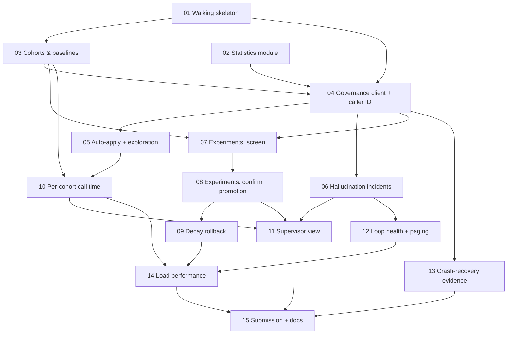

# Ticket map: Formi controller

Spec: `spec.md`. Tickets: `issues/NN-*.md`. Each ticket's `**Blocked by:**` line is the source of truth. This file is just the picture.

## Dependency graph



Critical path: **01 → 03 → 04 → 07 → 08 → 09 → 14 → 15**. Tickets 02, 05, 06, 10, 12 and 13 can be worked in parallel off that path.

## Status

When a ticket is finished, set its `**Status:**` line to `done` and tick its row here.

| # | Ticket | Blocked by | Done |
|---|---|---|---|
| 01 | Walking skeleton: loop, ingestion, restart | None | [x] |
| 02 | Statistics module | None | [ ] |
| 03 | Cohorts and history baselines | 01 | [x] |
| 04 | Governance client on the approval path, first used by degraded caller IDs | 01, 02, 03 | [x] |
| 05 | Auto-apply path and caller-ID exploration | 04 | [x] |
| 06 | Hallucination incident response | 04 | [ ] |
| 07 | Experiments: screen stage | 03, 04 | [x] |
| 08 | Experiments: confirm and promotion | 07 | [ ] |
| 09 | Decay rollback and holdback release | 08 | [ ] |
| 10 | Per-cohort call time | 03, 05 | [ ] |
| 11 | Consolidated supervisor view | 06, 08, 10 | [ ] |
| 12 | Loop health and paging | 06 | [ ] |
| 13 | Crash-recovery evidence | 04 | [ ] |
| 14 | Load performance on public_03 | 09, 10, 12 | [ ] |
| 15 | Grade reports, SUBMISSION.md and docs | 01–14 | [ ] |

**What can I start now?** It's any ticket whose blockers are all `done`. Quick check from the repo root:

```bash
grep -H -E '^\*\*(Blocked by|Status):' .scratch/formi-controller/issues/*.md
```
